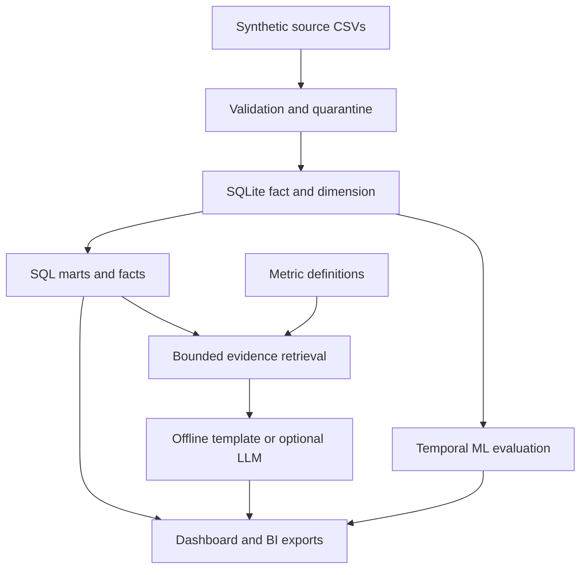

# PortfolioLens AI

**Loan portfolio monitoring with reproducible SQL metrics, evaluated machine learning, and an evidence copilot.**

Personal portfolio project for financial analytics and applied AI. The default build runs locally with **4,000 synthetic loans** and **60,461 raw monthly snapshot rows** covering August 2024 to September 2026. No employer or customer data is included.

## Project overview and media

[](media/PortfolioLens_AI_28s.mp4)

- [Watch or download the 28-second video](media/PortfolioLens_AI_28s.mp4)
- [Open the detailed project guide](docs/PROJECT_GUIDE.md)
- [View the model and data-quality evidence](docs/reference/)
- [Download the self-contained dashboard preview](demo/PortfolioLens_Demo.html), then open the file locally. This preview uses prepared sample answers; the Python app supports new questions within its evidence scope.
- [Get the LinkedIn post and project copy](media/)

Prepared for a standalone `portfoliolens-ai` repository. GitHub publishing was blocked by the connection permissions; this package has not been uploaded.

## The business question

A portfolio analyst needs to see whether delinquency is changing, where exposure is concentrated, whether data exceptions affect the report, and which loans deserve closer research. A dashboard answers the numerical questions; the model demonstrates prioritization; the copilot retrieves the exact metrics and their definitions.

## Run in five minutes

Use Python **3.12**. From the project folder:

```bash
git clone https://github.com/Ashish1400/portfoliolens-ai.git
cd portfoliolens-ai
python -m venv .venv
# macOS / Linux
source .venv/bin/activate
# Windows PowerShell alternative: .venv\Scripts\Activate.ps1
python -m pip install -r requirements.txt
python -m portfoliolens build
python -m unittest discover -s tests -v
python -m portfoliolens serve
```

Open **http://127.0.0.1:8765**. Stop the local server with Ctrl+C.

No API key is needed for data generation, SQL, ML training, the dashboard, or offline evidence answers. The first dependency installation needs internet access. Offline mode is a retrieved evidence template, **not LLM generation**.

Try the command line:

```bash
python -m portfoliolens ask "Which region has the highest delinquency rate?"
python -m portfoliolens ask "What caused the delinquency increase?"
python -m portfoliolens evaluate
```

If PowerShell activation is blocked, run `.venv\Scripts\python.exe` in place of `python` without activating the environment.

## What is implemented

| Layer | Working implementation |
|---|---|
| Data | Seeded monthly principal simulation; 24 duplicate rows and 36 invalid rows deliberately injected |
| Quality | Duplicate version resolution; money, ledger, DPD and foreign-key checks; separate quarantine log |
| SQL | SQLite fact/dimension model, monthly/segment/vintage marts, consecutive-month roll rates using `LEAD` |
| ML | Logistic regression and histogram gradient boosting; selection on validation average precision |
| Evaluation | Separate loans and later dates for validation/test; baseline comparisons, calibration, regional diagnostics |
| Copilot | Bounded intent routing, TF-IDF evidence ranking, source IDs, out-of-scope abstention |
| Optional LLM | Server-side OpenAI Responses API; strict JSON output; citation membership and numeric-prose checks |
| UI | Responsive local dashboard with portfolio, model, and copilot views |
| BI handoff | CSV exports, Power Query import example, DAX measures, relationship and page guidance |
| Checks | 19 Python tests; local HTTP smoke checks; GitHub Actions configuration |

## Actual reference run

Python 3.12, seed 42, 4,000 loans:

| Check / metric | Result |
|---|---:|
| Raw snapshot rows | 60,461 |
| Duplicate rows removed | 24 |
| Quarantined unique rows | 36 |
| Accepted snapshot rows | 60,401 |
| Test observations / positive events | 1,923 / 135 |
| Selected model | Histogram gradient boosting |
| Test ROC-AUC | 0.9571 |
| Test average precision | 0.5077 |
| Simple DPD-rule average precision | 0.3835 |
| Test Brier score | 0.0411 |
| Top-decile precision | 49.22% |
| Top-decile event recall | 70.37% |
| Top-decile lift versus random prevalence | 7.01x |
| Offline development cases | 24 / 24 expected behaviors |

**These results are synthetic-only.** ROC-AUC is not accuracy. Average precision is not the percentage of correct predictions. The simulator strongly links existing delinquency to future delinquency, so the simple-rule baseline is already strong. No real reduction in losses, review time, or reporting effort has been measured. The copilot cases are a small author-written development set, not a blind benchmark or an LLM factuality evaluation.

## How AI is used

1. **Predictive ML:** estimate the next-month 60+ DPD event for active loans currently below 60 DPD. Current features include DPD, payment ratio, utilization, DTI, balance ratio, months on book, risk band, product, and region. Future labels and loan IDs are excluded.
2. **Retrieval:** rank a small, curated set of computed fact cards and metric definitions using TF-IDF. This is a lexical baseline, not a neural embedding or semantic vector database.
3. **Optional generative AI:** use the retrieved source pack to write qualitative commentary. Exact numbers are displayed from computed evidence. Numeric characters in generated prose and unrecognized citation IDs are rejected.

Deterministic SQL calculates financial metrics. The LLM never runs SQL or changes data. Structural output checks do not prove that prose is semantically correct; review live responses before sharing them.

## Optional OpenAI mode

Set `OPENAI_API_KEY` and `OPENAI_MODEL` as server environment variables. Choose a model currently available to your account that supports the Responses API and structured outputs. `.env.example` is a template and is not automatically loaded. Do not put the key in HTML or commit it.

```bash
# macOS / Linux; enter your key locally, not in a public notebook
read -s OPENAI_API_KEY
export OPENAI_API_KEY
export OPENAI_MODEL="YOUR_AVAILABLE_MODEL_ID"
python -m portfoliolens ask "How was the model evaluated?" --mode openai
```

On PowerShell, set `$env:OPENAI_API_KEY` and `$env:OPENAI_MODEL` locally before starting the server. Optional API calls are billable under your API account. This delivered run made **no live OpenAI call**. Contract tests use a fake transport and dummy credentials. Network availability and model permissions must be checked in your environment.

## Architecture



## Repository map

| Path | Purpose |
|---|---|
| `portfoliolens/data.py` | Simulation and quality checks |
| `portfoliolens/pipeline.py` | Build, marts, manifests, computed fact cards |
| `portfoliolens/model.py` | Leakage controls, model selection, holdout results, monitoring queue |
| `portfoliolens/copilot.py` | Intent/range limits, lexical retrieval, optional LLM validation |
| `portfoliolens/evaluate.py` | Development-case evaluation |
| `portfoliolens/server.py` | Loopback development server and APIs |
| `sql/marts.sql` | Inspectable financial definitions and roll-rate SQL |
| `web/` | Dashboard HTML, CSS and JavaScript |
| `tests/` | Financial, model-split and copilot-contract checks |
| `docs/knowledge.json` | Source definitions and honest scope limits |
| `docs/eval_cases.json` | 24 supported and unsupported development questions |
| `docs/PROJECT_GUIDE.md` | Detailed walkthrough and portfolio presentation guidance |
| `docs/PROFILE_OPTIMIZATION.md` | Resume audit and LinkedIn/GitHub copy |
| `docs/GITHUB_PROFILE_README.md` | Paste-ready profile README |
| `bi/` | Power Query and DAX extension |
| `artifacts/` | Generated reports, database, CSVs, evaluation and audit logs |

The original downloadable package includes generated synthetic outputs. This GitHub publication includes compact reference outputs; run the build to generate the complete data and reports. Git ignores `data/` and `artifacts/`; CI regenerates them. Selected compact reference outputs are copied into `docs/reference/` for a public repository.

## Limits and next work

This is a functioning personal prototype, not an employer system or a production credit model. The data simulation omits interest, fees, recoveries, allowance accounting and many real portfolio behaviors. Invalid rows are excluded rather than repaired, so denominators and month-to-month continuity can change. The current copilot uses a narrow source pack and limited language routing; unsupported phrasing needs expansion and independent evaluation. Model results contain dependent repeated loan-months and no confidence intervals. Regional diagnostics are not a protected-attribute fairness audit.

The Power BI files are source examples, not a built or tested `.pbix`. GitHub Actions is configured but has not run on a remote repository. After publishing, check the repository Actions tab. Browser screenshot QA is not included in this reference run; JavaScript syntax and component-rendering smoke checks are included. No live LLM response has been evaluated.

Next useful additions: independently authored copilot holdout questions, a validated public-data connector, group-level bootstrap intervals, feature contribution analysis, a Power BI report verified against SQL, then deployment with authentication and monitoring if the scope requires it.

## Sources

- [Python SQLite documentation](https://docs.python.org/3/library/sqlite3.html)
- [scikit-learn: avoiding data leakage](https://scikit-learn.org/stable/common_pitfalls.html#data-leakage)
- [scikit-learn: model evaluation](https://scikit-learn.org/stable/modules/model_evaluation.html)
- [OpenAI: structured outputs](https://developers.openai.com/api/docs/guides/structured-outputs)

**Author:** Ashish Shinde. Development assisted by AI; inspect and understand the code before presenting it as your portfolio work.

## Publication notes

The original October 13, 2026 profile review and PDF playbook are retained as dated preparation documents. Statements in those documents about unpublished accounts, future repository setup or missing media describe the state before this upload. The source package now includes the demo, finished video, editable video source and proposed profile README. GitHub upload has not succeeded.

## Re-create the video

The finished video is `media/PortfolioLens_AI_28s.mp4`. Its editable HyperFrames source, local fonts, GSAP and measured reference data are under `media/source/`. See `media/README.md` for commands and verification.
